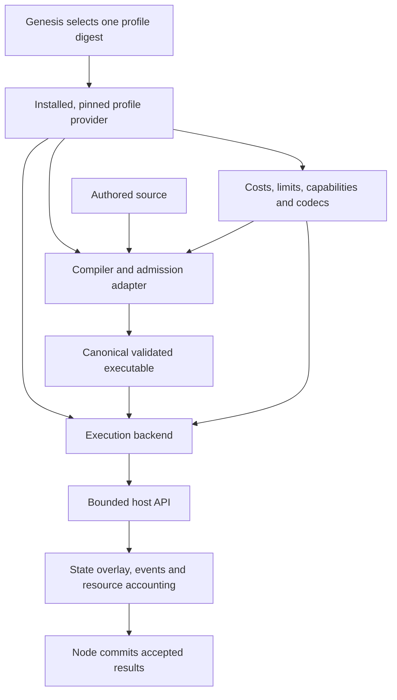

# Execution Profiles for New Chains

Status: proposed cross-repo architecture and implementation plan; implementation
has not started. This document
does not advertise alternate-runtime support in current releases.

Recorded: 2026-11-03.

## 1. Goal and scope

Allow a new chain to reuse the Xian node, state infrastructure and developer
tooling while selecting its contract language, execution rules, standard
library, resource costs and VM before genesis. Xian's existing behavior must
remain a supported, tested implementation of the same interfaces.

A chain chooses one execution profile at genesis and keeps it for that chain's
lifetime under this design. Another chain can choose a different profile,
including a different compiler frontend, Xian VM V2, or a different VM backend.
Developing a new profile may require writing code; the goal is supported
extension points without maintaining scattered patches to the node.

In scope:

- custom syntax that can target an existing VM;
- different allowed language features, host functions and semantic rules;
- versioned costs, resource limits and execution capabilities;
- replacement compiler/runtime packages for a newly created chain;
- deployment, simulation, tooling, genesis and replay that use that same choice;
- clear compatibility and conformance requirements for profile authors.

Out of scope:

- switching an existing chain's profile or migrating existing contracts;
- live activation heights, governance-controlled runtime upgrades or hot reload;
- different validators choosing different semantics for the same chain;
- multiple languages/VMs executing together on one chain or cross-VM calls;
- dynamically downloading arbitrary plugins from genesis or contract source;
- making consensus, account schemes, networking or every product feature generic;
- guaranteeing that existing Xian contracts run unchanged on a different VM.

This is separate from the current public-network launch plan. Current-code
defaults remain local; this work does not introduce a public chain ID or RPC
endpoint and must not become an implicit prerequisite for Xian's launch.

## 2. Current foundation and coupling

The following baseline was inspected when preparing this plan:

| Repo and revision | Useful foundation | Coupling to address |
| --- | --- | --- |
| `xian-contracting` at `e85f131d` | Separate Rust compiler and VM packages; storage and local harness; VM host interface | Compiler accepts the Xian VM profile; IR, values, host catalog and many costs assume Xian semantics |
| `xian-abci` at `a79e27f` | Execution adapter, explicit result types, execution-policy checks, serial/parallel execution and replay | Native bindings, compiler admission, stored IR, genesis and policy validation select one fixed runtime |
| `xian-stack` at `17b8390` | Reproducible images, five-node suites, corpus capture and architecture replay | Build dependencies, reports and workloads assume the Xian runtime/system contracts |
| `xian-py` at `2959aa8` | Shared signing/wire handling and public deployment/simulation APIs | Source-language and value assumptions need explicit compatibility checks |

At those inspected revisions the node policy names were `xian_vm_v1`,
`xvm-execution-5`, `xvm-gas-2`, `xvm-1` and `xian-set-1`. These identifiers are
evidence of explicit versioning, not an implemented plugin or upgrade system.
Use `COMPILER_RUNTIME_LAUNCH_STATUS.md` for the current V2-only node/public-client
boundary and the archival role of low-level native V1.

Source entrypoints:

- [Contracting architecture](https://github.com/xian-technology/xian-contracting/blob/e85f131db4e2a962f1ebbd3dbce70374343ae43c/docs/ARCHITECTURE.md)
- [Compiler options](https://github.com/xian-technology/xian-contracting/blob/e85f131db4e2a962f1ebbd3dbce70374343ae43c/packages/xian-compiler-core/src/compiler.rs)
- [VM host interface](https://github.com/xian-technology/xian-contracting/blob/e85f131db4e2a962f1ebbd3dbce70374343ae43c/packages/xian-vm-core/src/interpreter.rs)
- [Metering implementation](https://github.com/xian-technology/xian-contracting/blob/e85f131db4e2a962f1ebbd3dbce70374343ae43c/packages/xian-vm-core/src/metering.rs)
- [Node execution adapter](https://github.com/xian-technology/xian-abci/blob/a79e27fe188bd9278606eb4d8141d3eea4c99378/src/xian/execution_engine.py)
- [Node policy validation](https://github.com/xian-technology/xian-abci/blob/a79e27fe188bd9278606eb4d8141d3eea4c99378/src/xian/execution_policy.py)

Recheck these boundaries against the implementation revisions selected when work
starts. The inspected baseline is not a future release manifest.

## 3. Recommended architecture

### 3.1 Separate syntax, semantics and backend choice

The compiler owns parsing, language admission, diagnostics and lowering. The VM
owns execution semantics. The host provides chain context and controlled access
to state, events and approved native functions.

A new syntax can reuse the current IR and VM when its semantics fit them. An
alternate backend may have a different executable representation. Do not force
every backend through Xian's Python-shaped AST, `VmValue`, decorators or IR.
Adapters may translate into common boundary values, but those internal Xian
types must not become the mandatory extension interface.

The profile specifies supported combinations. Arbitrary mixing of a compiler,
VM and standard library is rejected unless that combination is explicitly
declared and tested.

### 3.2 Profile descriptor and release manifest

Define a strict, versioned profile descriptor containing:

| Field group | Required meaning |
| --- | --- |
| Identity | Descriptor schema, human-readable profile ID and immutable revision |
| Language/compiler | Language and compiler semantics IDs, compiler interface version, source admission rules |
| Runtime | Runtime semantics ID, backend interface version, executable format/version |
| Host/library | Host ABI version, enabled syscall catalog, standard-library revision |
| Resource policy | Exact cost table and deterministic cost formulas, execution/admission limits, arithmetic/rounding rules |
| Data policy | State key/value codec, argument/result/event codec, supported boundary types |
| Capabilities | Required features and supported execution services, including nested calls and optional parallel execution |

Specify canonical descriptor encoding and domain-separated hashing in phase 1.
Reject unknown fields, ambiguous numbers, duplicate keys and implicit defaults.
The digest covers all consensus-relevant parameters, including referenced
tables by immutable content hash. A display name alone never identifies policy.

Keep the profile definition separate from the chain launch manifest. The launch
manifest pins the profile digest, system-contract bundle, component source
revisions and per-platform build artifacts. Do not put an architecture-specific
binary/image digest into the common semantic profile digest: Linux ARM64 and
x86-64 must agree on the profile while using their respective pinned builds.
Matching IDs are not proof of equivalent implementation; release validation must
establish equivalence.

Fixing an implementation or updating tooling can retain the same profile only
when consensus-visible behavior is preserved and compatibility is demonstrated.
An immutable profile does not require freezing operational software forever.
Changing consensus semantics falls outside existing-chain support in this plan.

The profile can be reused by multiple chains. Chain ID and genesis identity stay
in chain context and transaction/replay protection, not in a language definition.
Define the profile/genesis hashing order without a self-referential digest.

### 3.3 Compiler provider contract

Specify versioned operations for describing capabilities, validating source,
compiling an admitted deployment, and validating its executable envelope.
Compilation receives the selected profile and explicit deterministic inputs.
It returns canonical executable bytes, callable/schema metadata, declared host
requirements, imports/dependencies and bounded diagnostics.

Validators remain authoritative for compilation. The initial generalized design
keeps source-backed deployment; it must not silently start trusting executable
artifacts submitted by clients. Offline compilation is diagnostic tooling using
the same compiler. A future artifact-only protocol would need its own design.

Executable/cache identities bind source, compiler/profile identity, module
identity, format and relevant dependencies. Recompilation and cache hits must
not change admission results or fees. Host-dependent paths, locale, timestamps
and filesystem/import search order must not affect artifacts.

### 3.4 Execution and host contracts

Define a narrow backend API for runtime description, executable preparation and
bounded call/constructor execution. Pin exact semantics for:

- inputs: selected profile, executable identity, entrypoint, encoded arguments,
  explicit chain/transaction context, state view and resource budget;
- outputs: success/revert/resource-exhaustion status, canonical result, writes,
  events, resource usage and tracked reads/prefix reads;
- nested calls: caller/signer/owner meaning, depth, shared budgets and atomicity;
- failures: contract errors versus infrastructure/backend faults, including a
  fail-closed node policy for faults that cannot safely be consensus outcomes.

The host owns authoritative state overlays, read/write tracking, namespace
permissions, event recording and resource accounting. A backend cannot bypass
these through direct database, filesystem, clock or network access. Backend
implementations are trusted installed code; the interface is not a sandbox for
malicious native plugins. The chain's contract sandbox remains mandatory.

Represent persistent boundary values with a specified codec and canonical bytes,
not live Python or Rust objects. Keep ORM helpers such as `Hash` and `Variable`
in the Xian adapter/library. Specify how a backend expresses storage keys,
prefix scans, deletion and missing values without requiring that ORM.

Node-controlled system metadata and user contract namespaces remain distinct.
Specify deterministic ordering for scans, events, writes and diagnostics that
enter receipts. Failed execution must discard its tentative state/events while
applying the profile's exact fee and failure rules.

Parallel execution is an optional optimization. New backends begin with serial
execution. Enable speculation only after host-recorded conflict detection,
fallback and serial/parallel equivalence pass; backend self-reported read sets
alone are insufficient. A disabled optimization cannot change results or costs.

### 3.5 Costs, limits and randomness

Distinguish operation costs from the token price charged per resource unit.
Inventory the existing fee-policy ownership before defining their boundary;
keep existing Xian fee behavior unchanged. A custom cost schedule is fixed in
the new chain's profile. Operational settings such as log verbosity are outside
that policy and cannot affect execution.

Inventory all metered paths, including compiler admission, instructions, memory,
collections, storage, transaction bytes, native crypto, scans and nested calls.
Extract cost data only where data suffices; version semantic cost algorithms
where formulas differ. Use bounded integer accounting with explicit overflow
and rounding behavior. Host-cost enforcement must remain effective even if a
backend mishandles its own instruction budget.

Every accepted execution path must have deterministic resource limits. Test
cache hit/miss, invalid input, failure and maximum-size behavior. Supply a cost
calibration/adversarial resource test process for chain authors; configurable
costs do not make arbitrary underpriced workloads safe.

Contract randomness uses explicit deterministic context. External cryptographic
proof generation and wallet key generation retain their own cryptographic
randomness. Profile generalization must not conflate those roles.

### 3.6 Genesis, state and system contracts

The genesis builder resolves a locally installed profile and compatible system
bundle, compiles its contracts with the selected compiler, and records policy
identity. Startup checks genesis, persisted state, installed backend and release
manifest before accepting work. Unknown or mismatched profiles fail explicitly;
there is no automatic fallback to Xian VM.

Snapshots, exports, BDS indexing/recovery, simulation, replay and node capability
reports carry/check the same identity. Prepared artifacts and caches must not be
reused across profiles. Keep consensus state encoding separate from convenient
SDK wire presentation; both need explicit, validated contracts.

System contracts are a real dependency. A new language/backend must supply or
port the compatible currency, deployment and governance behavior required by the
node, including names and callable schemas that the chain bundle declares.
Inventory these assumptions rather than promising that swapping a VM makes all
Xian system contracts portable. Optional ZK, relayers and application packages
are advertised only when their declared capabilities and tests are satisfied.

For the existing Xian profile, preserve its frozen baseline behavior, state
encoding and admission rules. Any compatibility adapter for the current genesis
format must be explicit and Xian-specific. Do not silently reinterpret existing
state or add profile metadata that changes existing Xian roots. New profile
genesis formats must require their descriptor rather than treating omission as
a default.

## 4. Ownership and dependency direction

| Owner | Responsibility |
| --- | --- |
| `xian-meta` | Shared profile, compiler/backend/host contracts and conformance acceptance criteria |
| `xian-contracting` | Compiler/runtime providers, descriptor validation/neutral interfaces initially, host adapters, local execution tooling and test corpus |
| `xian-abci` | Provider selection, admission, transaction orchestration, system-bundle integration, execution output boundary, simulation, BDS and replay |
| `xian-configs` | Explicit chain profile references and compatible genesis/system-contract manifests |
| `xian-cli`, `xian-stack`, `xian-deploy` | New-chain setup, dependency resolution, pinned builds, platform checks, startup diagnostics and five-node validation |
| `xian-py`, `xian-js` | Profile discovery, argument/result codecs, deployment and simulation support; explicit unsupported-profile errors |
| `xian-linter`, `xian-ide-web`, `xian-playground-web` | Compiler/language selection and accurate capability reporting |
| `xian-contracts` and system-contract owners | Compatibility declarations and test/port work for selected bundles |
| `xian-docs-web`, AI guides/skills | Author/operator guidance once corresponding support actually exists |

Neutral interface definitions must not import the Xian compiler/interpreter or
node. Concrete adapters implement those interfaces; the node depends on the
interface and installed provider registration. Start within the existing package
layout. Create a new distribution/repo only if the second real consumer shows
that independent ownership/versioning is needed; follow
[shared package extraction guidance](SHARED_PACKAGE_EXTRACTION_PLAN.md).

Do not modify the exempt IntentKit fork as part of this architecture work.
Downstream integrations consume supported SDK/profile capabilities.

## 5. Delivery sequence and acceptance gates

Each phase is a separately reviewable change set with owning-repo tests and
documentation. Create implementation issues/PRs in those repos when work begins,
linking back here rather than copying this design into parallel documents.

### Phase 0 — Freeze evidence and inventory assumptions

Record exact component revisions and capture the existing Xian compiler,
runtime, metered execution, serialization, system-contract and replay baseline.
Inventory hardcoded profile names, compiler calls, host catalogs, costs, limits,
ORM assumptions, system-contract calls and artifact/cache identities across the
owners above. Mark each as neutral infrastructure or profile-owned behavior.

Exit: reviewed dependency map and explicit compatibility fixtures, including
current deployment, errors, fees, state roots and snapshot/replay behavior.
No profile abstraction is declared complete based only on renamed identifiers.

### Phase 1 — Specify the extension contracts

Finalize the descriptor schema/hash, compiler/backend/host API, boundary codecs,
failure model and system-bundle contract. Specify API compatibility and required
capability negotiation. Build schema fixtures for valid and invalid descriptors.
Choose the smallest neutral type boundary that can serve a genuinely different VM.

Exit: concrete interface examples for Xian and an independent minimal backend;
testable acceptance criteria for unsupported/mismatched combinations. Review the
tradeoff between reusing current codecs and adding new ones before implementation.

### Phase 2 — Adapt Xian through the interfaces

Wrap the current compiler, VM, host functions and local harness as the first
provider. Route node preparation/execution and compilation through it. Preserve
the current Xian baseline, including intentional failures and exact charged costs.
Keep backend and policy checks strict while removing scattered Xian-specific
selection from generic orchestration.

Exit: baseline equality, existing native/WASM compiler checks, full five-node
E2E and Linux architecture replay pass using the adapter. Profile cache-isolation
and error-path tests pass. No alternate-chain behavior is promised yet.

### Phase 3 — Add profile selection for fresh genesis

Implement descriptor validation, installed-provider registration and chain
manifest resolution. Extend genesis, startup, snapshots, replay, BDS and node
capability reporting. Bind system bundles and executable identities to the
selected profile. Resolve exact dependencies before creating chain state.

Exit: a fresh local chain boots with an explicit profile. Wrong runtime, compiler,
host ABI, codec, cost table, executable, snapshot or persisted profile is rejected
before execution. Cross-chain replay protection remains intact even when two
chains share a profile. Existing-chain switching remains unsupported.

### Phase 4 — Prove cost and language extensibility

Create a test/example cost variant of the Xian provider with intentional,
documented differences and a separate profile identity. Create a small alternate
syntax frontend that targets the current VM where semantics permit. Exercise
both through real validator compilation, deployment, calls and simulation.

Exit: cost-variant tests prove the expected resource-charge changes while
application outcomes remain equivalent where intended. Alternate-syntax tests
prove source admission and execution without routing source through the Python
frontend. Generic node control flow has no language-specific branch added for
the example. Distinct chains can coexist without cache or artifact contamination.

### Phase 5 — Prove a different backend can work

Implement an independently structured, deterministic reference backend, for
example a bounded integer stack machine with its own executable format and
compiler. It must perform real storage, events, metering, failures and required
system-bundle interactions; relabeling/delegating execution to Xian VM does not
prove this boundary. Give it a deliberately small supported language surface.

Exit: a new five-validator chain deploys and executes contracts using that backend,
with its compatible system bundle and profile-aware SDK/CLI path. Invalid and
resource-exhausted transactions roll back correctly, nodes agree, and captured
blocks replay identically on supported Linux architectures. Remaining intentional
Xian-only SDK/product features fail clearly or are marked unavailable.

The reference backend is conformance evidence, not an endorsement for production
funds. A production replacement or V2 needs its own semantic/security review and
profile-specific coverage.

### Phase 6 — Package the supported authoring path

Publish a profile-author guide, provider template, conformance runner and pinned
example manifests. Document exactly which SDK, linter, IDE and deployment paths
support each profile and which need language-specific adapters. Make local test
harness execution use the selected backend. Give each profile independent
semantic models and immutable historical observations where appropriate;
current conformance must not require a maintained CPython contract executor or
require another language to mimic Python.

Exit: a developer can follow a clean-workspace guide to define a profile, install
its provider, build matching validators, generate fresh genesis, deploy a contract,
simulate/call it, and run conformance plus five-node/replay tests without editing
generic node source. Diagnostics identify unsupported/mismatched components.

## 6. Required evidence matrix

| Area | Required checks |
| --- | --- |
| Xian preservation | Canonical compiler outputs, values, success/failure results, events, fees and state-root fixtures match the frozen baseline |
| Descriptor identity | Canonical hashes; malformed/unknown fields rejected; no hidden defaults; one-field changes invalidate identity |
| Compiler admission | Accepted/rejected syntax, bounded parsing/lowering, deterministic artifacts, no client executable bypass |
| Backend/host boundary | Typed codec rejection, namespace isolation, bounded native calls, nested budget/rollback, infrastructure failure handling |
| Metering | Every operation class, max-size inputs, overflow/rounding, failure costs, warm/cold cache equivalence, adversarial underpricing probes |
| State | Missing/deleted values, deterministic scans, atomic writes/events, snapshot/export/reopen/replay identity |
| Isolation | Different profiles and chains cannot share incompatible cached artifacts, contexts or system bundles |
| Determinism | Host environment/seed/order variations, clean restart, exact metered observations and architecture replay |
| Concurrency | Serial baseline; speculative execution only after conflicts, prefix reads, rollback and scheduling-order equivalence pass |
| End-to-end | Fresh five-node chains for Xian, custom-cost/syntax variants and independent backend; SDK simulation agrees with committed execution |
| Optional features | ZK/native syscalls, relayers and apps tested only for profiles declaring support; required capabilities cannot silently skip |

Primary server targets are Linux x86-64 and ARM64. Include Apple Silicon macOS
compiler/runtime tests and the supported ARM64 Docker node path. Windows node
operation is not supported and is not an acceptance gate.

Capture exact source revisions, profile descriptors/digests, build provenance,
test reports and replay artifacts. Profile-neutral conformance tests establish
the shared contract; each language/backend also needs its own semantic corpus.
Passing a shared smoke test is insufficient to establish a new VM's correctness.

## 7. Decisions and completion criteria

Recommended defaults, to retain unless a concrete implementation need changes
them during interface review:

- one immutable profile per newly created chain;
- installed, pinned providers selected from an explicit registry;
- source-backed validator compilation for the initial supported deployment flow;
- a separate profile descriptor and chain release/system-bundle manifest;
- Xian adapters preserve current semantics and keep implementation-specific types
  behind the boundary;
- serial execution first for a new backend;
- custom costs/syntax demonstrated before adding a second real backend;
- no package/repo split solely for naming or branding.

Design choices to settle in phase 1 include the minimal common value codec, the
exact system-bundle ABI, and provider packaging/registration mechanics. These
are implementation decisions, not a reason to expand the agreed scope into live
upgrades. Record their rationale here or in linked owning-repo design decisions.

The goal is complete when a new-chain author can select or implement a different
profile through documented extension points, launch a fresh validated chain and
pass its declared conformance gates, while the existing Xian profile retains its
baseline behavior. The independent-backend demonstration is mandatory evidence
that the infrastructure is reusable.

Related documents:

- [Workspace orientation](WORKSPACE.md)
- [Current compiler/runtime launch status](COMPILER_RUNTIME_LAUNCH_STATUS.md)
- [Existing Xian VM execution model](XIAN_VM_EXECUTION_MODEL.md)
- [Mainnet launch plan](MAINNET_LAUNCH_PLAN.md)
- [Change workflow](CHANGE_WORKFLOW.md)
