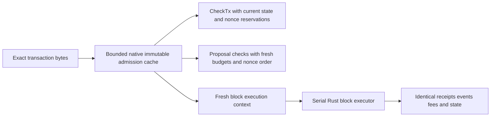

# Transaction Throughput Optimization Plan

Status: proposed implementation sequence, based on the 19 November 2026
five-validator investigation. Runtime behavior has not been changed by this
plan.

Improve successfully committed TPS and confirmation latency by removing
repeated admission work and unnecessary conversions before designing parallel
contract execution. Preserve transaction acceptance rules, ordered execution,
fees, chi, receipts, events and application hashes.

This is the shared contract between `xian-abci` (admission and block lifecycle),
`xian-contracting` (native admission and execution bindings), and `xian-stack`
(workload generation, profiling and CI). Implementation details stay in those
repos. The existing [parallel execution plan](XIAN_VM_PARALLEL_EXECUTION_PLAN.md)
remains the reference for a future Block-STM executor.

## Evidence and its limits

The committed [baseline extract](TRANSACTION_THROUGHPUT_BASELINE_2026_11_19.json)
records the image, measured source revisions, settings and selected observations.
The experiment used an Apple M1, five ARM64 Docker validators sharing one
8-CPU/approximately 7.65-GiB VM, paid metering, no BDS, and the throughput
consensus profile. Transactions were simple `currency.transfer` calls with
explicit nonces and 500 chi, signed before timing. All reported successful
runs verified exact committed transaction hashes, receipt success, balances,
nonces and agreement between the five validators.

| Observation | Bounded load | Flooded queue |
| --- | ---: | ---: |
| Transactions in the profiled run | 3,000 | 6,000 |
| Diagnostic committed TPS | 296.00 | 157.39 |
| CheckTx calls, summed across five nodes | 30,147 | 110,167 |
| CheckTx share of measured callback time | 44.69% | 54.77% |
| Proposal packing share | 1.41% | 8.40% |
| FinalizeBlock share | 47.44% | 33.12% |
| Largest observed proposal packing call | 92.57 ms | 613.62 ms |

These are application callback duration shares summed across validators, not
CPU percentages or end-to-end wall-time shares. The profiler snapshots bracket
post-run verification and its empty-block fence as well as submission. The two
arms used different operation counts and ran sequentially on a growing chain;
they motivate matched experiments rather than establish a causal speedup for
any particular fix. Proposal timeout events are correlated observations, not
proof that every timeout was caused by proposal packing.

The unprofiled capacity investigation reached 365.30 TPS in one 5,000-transfer
sample. Three 10,000-transfer runs had a 279.67-TPS median and a 201.51–347.18
range. This variation is too wide to adopt those values as calibrated CI gates.
The earlier 11–16.5k transactions/second figures in
[the single-engine history](XIAN_SINGLE_ENGINE_PLAN.md) measure static admission,
not complete transaction execution and consensus.

Source inspection establishes the following:

- CheckTx, PrepareProposal, ProcessProposal, FinalizeBlock and Commit share the
  node's state-transition lock. Making admission cheaper can therefore help
  block production as well as submission latency.
- Each call to the native static admission function decodes the wire document,
  verifies the signature and validates the canonical payload. No successful
  static-admission result is currently reused between those node callbacks.
- PrepareProposal scans the supplied candidate list even when the chi budget
  is exhausted. At 500 supplied chi and a 500,000-chi block cap, at most 1,000
  of these transfers fit in a block.
- CheckTx also performs live balance, chi-rate and nonce-reservation work.
  Its measured 55% share must not be described as signature-verification time.
- `BlockExecutor.add(raw)` reparses transaction inputs. It does **not** repeat
  the complete static signature-validation path. Its block-specific context
  must be rebuilt even when immutable transaction inputs are reused.
- `finalize_execute` combines native preparation/execution, Python outcome
  conversion and receipt construction. Pure VM time has not been isolated.
  Result assembly/encoding consumed about 29–30% of finalization time.

## Design boundaries

Separate four kinds of data:

1. **Immutable admission facts:** exact wire bytes, canonical signed payload,
   signature validity, chain identity and canonical numeric/wrapper grammar.
2. **Live admission state:** current fee policy and chi rate, sender balance,
   committed nonce, pending reservations, expiration and per-sender capacity.
3. **Block execution context:** height, timestamp, block hash, policy, runtime
   features and the block-specific input hash.
4. **Execution outcomes:** ordered state changes, fees/rewards, events, failure
   results and receipt bytes.

Only the first category is reusable across commits without consulting state.
An admission-cache hit never authorizes a transaction by itself.

Keep upstream CometBFT, paid fees, gas rules, chi caps and consensus defaults
unchanged in the primary comparison. Do not disable mempool rechecks, remove
the state lock, skip signature checks on caller assertion, or omit receipt
fields to produce a larger headline number. Storage layouts and timeout values
may be compared as separately labelled diagnostic arms.

## Implementation order

| Step | Deliverable | Owner | Depends on |
| --- | --- | --- | --- |
| 0 | Reproducible capacity harness and finer profiling | stack, abci, contracting | Existing evidence |
| 1 | Stop proposal scans when no valid transaction can fit | abci | 0 |
| 2 | Bounded reuse of successful immutable admission | contracting, abci | 0; measure separately from 1 |
| 3 | Reduce measured live-admission and nonce overhead | abci; native helpers only if justified | 2 and a new profile |
| 4 | Reduce input and receipt conversion work | contracting, abci | 2 and a new profile |
| 5 | Bounded stateless admission scheduling, if still needed | abci, contracting | 3 and 4 measurements |
| 6 | Reassess storage, consensus timing and parallel execution | stack, abci, contracting | Optimized serial baseline |

Each step is a separately reviewable change with its own before/after evidence.
Reprofile after steps 1 and 2; steps 3–5 are conditional, not permission to
implement every mechanism regardless of its measured value.

### Step 0 Establish a trustworthy measurement contract

Promote the useful parts of the local experimental drivers into the stack's
maintained benchmark harness. Keep three distinct measurements: admission rate,
prepared manual capacity, and SDK automatic end-to-end throughput. Preserve the
current manual client measurement as a separate series if signing moves outside
the clock; change the measurement identifier/schema and establish fresh
baselines rather than silently comparing different definitions.

The capacity clock starts immediately before first broadcast and ends when the
final expected transaction's application state is committed. Verify receipts,
exact wire hashes, all sender nonces, recipient balances and the five-validator
state agreement afterward. Count successful committed transactions, never
HTTP acknowledgements. Keep CheckTx and async broadcast as labelled transport
arms; neither waits for individual execution results during sending.

Add bounded inflight windows and explicit offered-rate control alongside the
flood arm. Use the same transaction count for bounded/flood comparisons. Fix the
maintained runner's default serial receipt resolution and double signing in
the capacity path. The short block-window TPS calculation currently counts
the first block while its denominator starts at that block's timestamp; stop
using it as a capacity measurement and define/test any diagnostic window with
matching numerator and time boundaries, including single-block cases.

Preflight workload funding from transfer amount, transaction count, supplied
chi and the committed chi rate, with explicit headroom. Respect the pending
nonce cap per sender, including when funding wallets from one founder; fund in
bounded batches. Fail before timing if the founder cannot fund the campaign.
Do not work around insufficient funds by changing fee mode or counting failed
transactions. Keep deterministic workload shapes, while private signing seeds
and keys remain temporary and excluded from public artifacts.

Add diagnostic counters/timers for:

- initial versus recheck requests (the ABCI adapter currently drops CheckTx
  type), immutable decoding/signature work, live balance/rate checks and nonce
  bookkeeping;
- lock queue time versus callback service time, candidate scans versus included
  transactions, cache hits/misses/evictions/retained bytes;
- native input preparation, the Rust execution loop, conversion to Python,
  receipt normalization/encoding, Commit, ABCI protobuf/transport and actual
  response bytes;
- unique consensus height/round retries, mempool depth/age, CPU, RSS, event-loop
  delay and storage latency.

Use bounded labels and aggregate metrics; avoid per-transaction logging and
sender/hash labels. Profiling must not influence fees, admission or consensus
outputs. Compare profiling-on/off overhead. Run matched fresh-state baselines
with interleaved baseline/candidate order, identical warm-up and fixed resource
limits. Include one versus five validators, native Linux evidence, and an
optional macOS bind-mount versus Docker-native-volume diagnostic to separate
shared-host overhead from protocol work.

**Gate:** every requested transaction is accounted for; timing semantics are
documented and tested; counters reconcile across phase boundaries; at least
five paired samples establish the reference runner's noise. Preserve cold and
warm admission-cache arms. No absolute production TPS claim follows from this
single-host campaign.

### Step 1 Avoid work after proposal capacity is exhausted

In `xian-abci/src/xian/methods/prepare_proposal.py`, terminate candidate scanning
once a metered block has exactly zero remaining chi. All valid metered user
transactions require positive supplied chi, so no later candidate can fit.
Likewise stop at exactly exhausted byte capacity where its request semantics
permit it. Leave unmetered system behavior explicit.

Do not stop merely because one transaction is too large: a later smaller
transaction may fit. Keep scanning for that case, and never advance the
proposal nonce tracker for a skipped transaction.

**Proof:** extend `tests/abci_methods/test_proposal_validation.py` with exact-fit,
positive remainder, mixed budgets, invalid candidates, byte limits and
same-sender gaps. Compare selected transaction bytes against the original
implementation. A full-budget fixture must perform no admission work on its
remaining candidates. Measure candidate counts and proposal latency under the
same large backlog; do not change the 500-ms timeout in this comparison.

### Step 2 Reuse immutable admission safely

Introduce an application-scoped native admission cache in `xian-vm-core` using
the existing `admit_transaction` rules as its sole authority. Keep the existing
pure decoding/validation API for uncached callers and parity tests.

The proposed cache owns immutable admitted-transaction entries. Bind entries
to exact wire bytes, chain identity, VM profile and installed admission
revision. A byte digest may index a lookup, but identity must also establish
the retained exact bytes. Enforce each caller's maximum raw size before a
cache lookup. Bound both entry count and retained raw/decoded memory, with LRU
eviction; select initial limits using step 0's working sets and RSS evidence.
Cache successful static admission only. Misses, eviction and cache-disabled
operation must use the same authoritative rules and produce identical results.

Do not retain a mutable Python transaction dictionary in shared cache entries:
FinalizeBlock adds `b_meta`. Give callers read-only scalar access and fresh
mutable materialization when required. No arbitrary dictionary, public
`already_validated` flag or pickled object can construct a trusted native
entry. Scope cache lifetime to one initialized application/runtime, with cold
restart and revision/chain changes unable to reuse entries from another scope.

Reuse entries from CheckTx, PrepareProposal, ProcessProposal and final decode,
but continue every phase's current fee/cap, state, nonce and ordering checks.
Keep `SequentialNonceTracker` independent of node-local mempool reservations.
Cache contents must never change proposal validity or finalized outputs.

**Proof:** warm/cold/disabled-cache parity against the admission golden corpus;
mutated bytes/signatures, wrong chain/revision, stricter per-call size limits,
eviction/churn and mutation-isolation tests; concurrent app instances; balance,
nonce, fee-policy and chi-rate changes after a cached admission. For a retained
working set, repeated callbacks should increase cache hits instead of native
signature-verification counts. Total CheckTx call count may remain unchanged.
Benchmark improvements rather than attributing all CheckTx cost to this cache.

### Step 3 Optimize live admission only where the new profile points

First measure the remaining balance/rate reads, decimal/binding overhead and
nonce bookkeeping. Preserve CheckTx type for observation and correct request
handling; `RECHECK` alone is never evidence that live checks can be skipped.

Candidate improvements, implemented one at a time:

- Reuse the committed chi rate and sender state within a well-defined committed
  state generation, or read them through one native read view. Invalidate on
  successful Commit and every explicit restore/reset/state replacement. Test
  governance updates and the detached FinalizeBlock/Commit boundary before
  adopting this: a pending block must never populate an admission read cache.
  Keep the lock until snapshot and ownership semantics are proven.
- Avoid repeated full TTL scans when a sender's reservations cannot yet have
  expired. Preserve monotonic-time boundaries, identical recheck TTL renewal,
  holes, expired reservations, the sender cap and commit reconciliation.
- Only add a cached contiguous nonce frontier or expiry index if profiling
  justifies it. Highest reserved nonce is not the next nonce when a gap exists.
  Every setter, pruning path, reconciliation and flush must maintain or
  invalidate derived indexes.

Do not cache an overall CheckTx acceptance result across commits. A previously
valid transaction can become unaffordable, stale or over a governed cap.

**Proof:** extend nonce/CheckTx/commit/storage-isolation tests, including duplicate
hash versus same-nonce replacement, missing middle nonce, expiry/renewal,
pending-cap saturation, failed Commit and retry, balance changes and governed
fee/rate updates. Use randomized command sequences against the original nonce
implementation as an oracle before replacing its bookkeeping structure.

### Step 4 Reduce native input and receipt conversions

Use a new profile to split two independent subchanges:

1. Let the external block path consume immutable admitted native inputs without
   reparsing them through `BlockExecutor.add(raw)`. Derive timestamp, height,
   block hash, current policy/features and `__input_hash` freshly per block.
   Preserve a distinct internal system-unmetered path: synthetic system calls
   must not be forced through external signature-admission rules.
2. If receipt work remains material, reduce repeated traversal/materialization
   in `processor._native_response`, `finalize_block._assemble_tx_results`,
   `block_executor_python.outcome_to_py` and `utils/encoding.py`. Start with
   measured duplicate passes; introduce native receipt-byte generation only
   if its extra API and conformance burden are justified.

The receipt encoder is **not** the LMDB stored-value encoder. Preserve exact
JSON bytes, key order/escaping, numeric wrappers, sets, byte forms, datetime
forms, error text, events, writes and reward records. Keep CometBFT wire hashes,
the application's receipt hash and the block-specific input hash distinct.
Retain nonce staging, protobuf events, traces and BDS envelopes. Do not remove
fields, truncate results or change output metering to reduce serialization cost.

**Proof:** `test_transaction_inputs_parity.py`, engine parity, receipt value/set
encoding/output-boundary corpora, paid/free/system fee cases and failed paid
transactions; byte-identical ordered receipts, charges and app hashes. Test
BDS enabled as well as disabled, and the existing SDK/query consumers of
`encode_abci_json`. Native execution charge and module-preparation limits must
be identical with warm/cold caches and across supported architectures.

### Step 5 Consider bounded stateless admission scheduling

Only pursue this if lock queue time/event-loop blocking remains important
after the previous reductions. Keep live state checks and reservations under
one owner. Moving synchronous Python work outside `async with` alone does not
make an event loop concurrent.

An experiment may dispatch immutable native decoding/signature work to a small,
bounded worker pool with the GIL released, then re-enter the current state lock
for live checks. Preserve response ordering, Flush behavior, cancellation and
shutdown. Bound queue length, memory and concurrency under invalid-input floods;
do not starve consensus callbacks or oversubscribe five validators on one host.
This is parallel admission, not parallel contract execution.

**Gate:** workload and adversarial-load measurements improve commit throughput
or confirmation latency, while ordering, admission results and state-isolation
tests remain exact. Drop this mechanism if its scheduling overhead loses to
the optimized single-threaded admission path.

### Step 6 Reassess the remaining capacity limit

Separate remaining time into native execution, receipt/transport work,
consensus rounds and persistent storage. A longer propose timeout can reduce
false round changes without increasing execution capacity; evaluate it as a
separate local arm after reducing proposal work, with identical transaction
limits. Do not silently raise block chi limits or alter production defaults.

Reopen Block-STM only if optimized profiles show sufficiently dominant native
execution and a prototype demonstrates an end-to-end gain on independent
transfers. Shared fee/reward writes, same-sender dependencies, hot DEX state,
speculative rollback and deterministic rounding must retain serial results.
Do not parallelize the existing iterator or share the current `unsendable`
block executor across worker threads; this requires a new state/scheduler
design, not a concurrency switch.
The five validators each repeat the whole block; this work does not partition
transactions across validators. There is no justified 11–15k committed-TPS
forecast from the admission microbenchmark.

## Acceptance and release discipline

Correctness gates apply to every increment: same acceptance/errors for the
same current state, identical ordered block receipts/events/fees/chi and app
hashes for the same signed block corpus, and bounded memory/work under hostile
inputs. A diagnostic cache or timer never becomes consensus state. Do not
update golden fixtures to hide an optimization-induced difference.

Evaluate cold and warm cache cases, repeated and unique transactions, invalid
signature/oversize traffic, mixed budgets, paid/free policies, deploys and
runtime failures, governance changes, restarts/replay, simulator traffic and
BDS on/off. Use targeted tests per commit; run the full release safety,
determinism and native cross-architecture replay gates for the combined runtime
candidate. Any normative rule change requires a separate protocol/version
decision rather than being bundled into a performance patch.

Performance targets are hypotheses to validate: remove unnecessary candidate
decodes after capacity is exhausted; approach one static verification per
retained unique transaction per node/runtime scope; reduce targeted callback
cost and demonstrate a paired committed-TPS/latency gain beyond measured noise.
Report median, range, p95 confirmation latency, backlog growth and failures.
Do not accept a faster submission microbenchmark as an end-to-end improvement.

Run five or more alternating baseline/candidate samples on identical hardware
and fresh equivalent state. Keep simple transfers as the primary capacity
case, with contract-heavy/mixed traffic as guardrails. Establish control variance
with baseline-against-baseline pairs first, then compare paired speedup ratios
and p95 latency against a predeclared tolerance. Extend ambiguous campaigns
instead of selecting the best sample. The previous sustainable offered rate
must not develop growing backlog or failures. Reprofile after each increment
and stop adding complexity when the target is no longer dominant.

The hosted performance workflow currently builds release-manifest sibling
revisions. Add a candidate manifest or explicit immutable candidate revisions
for experiments; otherwise an ABCI/runtime branch change will not be tested.
Keep PR correctness and operation-count tests reliable on hosted runners;
initial nightly performance results remain observational until variance is
calibrated. Require an explicitly accepted reference for regression gates,
retain its provenance, and replace expiring artifacts deliberately. Do not
automatically promote a slower run into the baseline. A future dedicated runner
can support tighter thresholds than the initial hosted policy.

Implementation introduces native APIs/package compatibility as needed, with
clear startup checks and coordinated pins. Internal caches need no execution
revision change if normative behavior is proven unchanged. Runtime/API/operator
changes must update the relevant `xian-docs-web` performance/configuration pages
in the implementation changes, not make this proposed plan appear shipped.

## Source entrypoints and first work package

- `xian-abci/src/abci/server.py`: CheckTx type/dispatch and response transport.
- `xian-abci/src/xian/xian_abci.py`: state lock and callback timings.
- `xian-abci/src/xian/methods/{check_tx,prepare_proposal,process_proposal,finalize_block,commit}.py`:
  phase rules, budgets, assembly and commit lifecycle.
- `xian-abci/src/xian/{nonce,fee_policy,processor}.py` and
  `src/xian/utils/{tx,encoding}.py`: live checks, reservations and receipts.
- `xian-contracting/packages/xian-vm-core/src/transaction_admission{,_python}.rs`,
  `transaction_inputs.rs`, `block_executor{,_python}.rs`: native authority,
  immutable-input reuse and outcome conversion.
- `xian-stack/scripts/localnet-{tps-bench,workload,perf-summary}.py`,
  `scripts/localnet_benchmark_checks.py`, and
  `.github/workflows/localnet-performance.yml`: maintained measurements and CI.

The first implementation package is step 0 followed by step 1: make the
measurement reusable, split the missing timings, and prove that a full block
does not decode its unused candidate tail. Then implement and measure the
bounded admission cache as its own change. Choose the subsequent live-state
and receipt work from the resulting profile.
